# Anura · Análisis

<picture><source media="(prefers-color-scheme: dark)" srcset="docs/mascota/gota-feliz-oscuro.svg">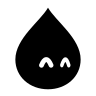</picture>

**Resumen.** Esta web muestra los datos, las cifras y el análisis de **Anura**, una app para la identificación de anuros de Colombia. Reúne cómo se reparten las especies, cuánto acierta el modelo, qué mejora aporta la ubicación y cómo reaccionan los centroides ante especies que el modelo no conoce. Para usar la app, pulsa **Probar**: [anura.juanlabs.me/inicio](https://anura.juanlabs.me/inicio).

<br clear="left">


| Cifra | Qué es |
|---|---|
| **300** especies | El catálogo, repartido en 14 familias. |
| **178.307** registros | Observaciones de GBIF Colombia de las 300 especies (12 de septiembre de 2026). |
| **41** especies | Las que el modelo identifica hoy. |
| **57,05 %** | Acierto a la primera solo con la foto (766 fotos de prueba). |
| **82,1 %** | Acierto con foto y ubicación (680 fotos con coordenadas). |
| **0,60** | Correlación entre la separación de los centroides y el acierto; con el número de fotos es 0,06. |
| **93,4 % → 87,1 %** | Fotos de especies desconocidas que pasan por conocidas: solo imagen frente a dos etapas con ubicación. |

## Tabla de contenidos

1. [Estructura del proyecto](#estructura-del-proyecto)
2. [Resultados y análisis](#resultados-y-análisis)
3. [Pila tecnológica](#pila-tecnológica)
4. [Metodología ágil (Scrum + XP)](#metodología-ágil-scrum--xp)
5. [Ciclo de Machine Learning (CRISP-ML)](#ciclo-de-machine-learning-crisp-ml)
6. [Arquitectura de datos: transacciones ACID](#arquitectura-de-datos-transacciones-acid)
7. [Instalación y puesta en marcha](#instalación-y-puesta-en-marcha)
8. [Uso de la web](#uso-de-la-web)
9. [Publicación en GitHub](#publicación-en-github)
10. [Cómo leer las cifras](#cómo-leer-las-cifras)

## Estructura del proyecto

El proyecto sigue el esquema de la pizarra: el desarrollo se documenta, vive en GitHub, se organiza con un método ágil y entrega un dashboard sobre datos ACID.

```text
               ┌────────────────────────────────────────────────────────┐
               │          "Desarrollo de Software" (DOCUMENTAR)         │
               └───────────────────────────┬────────────────────────────┘
                                           │
          ┌────────────────────────────────┼────────────────────────────────┐
          ▼                                ▼                                ▼
  ┌───────────────┐              ┌───────────────────┐             ┌────────────────┐
  │  Aplicación   │              │   Método Ágil     │             │   Machine      │
  │    GitHub     │              │    Scrum / XP     │             │   Learning     │
  └───────────────┘              └─────────┬─────────┘             └───────┬────────┘
                                           │                               │
                                           └───────────► CRISP-ML ◄────────┘
                                                            │
                                  ┌─────────────────────────┴───────────────────────┐
                                  ▼                                                 ▼
                        ┌──────────────────┐                              ┌──────────────────┐
                        │   "Dashboard"    │                              │      DATOS       │
                        │  Web estática    │                              │       ACID       │
                        └──────────────────┘                              └──────────────────┘
```

El dashboard es una web estática (HTML, CSS y JavaScript) que se publica tal cual en GitHub Pages.

```text
analisis-anura/
│
├── database/
│   ├── schema.sql                 # Esquema relacional DDL y restricciones CHECK
│   └── anura_acid.db              # Base SQLite generada por la carga
│
├── src/
│   └── build_data.py              # Carga ACID: fuentes → SQLite → JSON
│
├── data/                          # JSON que lee la web (los genera build_data.py)
│   ├── distribucion.json
│   ├── centroides.json
│   ├── modelo.json
│   ├── mejora.json
│   └── openset.json
│
├── home/                          # Inicio: portada, resumen en dona y los cinco campos
├── distribucion/  centroides/  precision/  mejora/  openset/
│                                  # Un campo cada uno: index.html + modulo.js
├── assets/
│   ├── app.js  app.css            # Navegación, mascota viva y gráficos animados
│   ├── ndg.js  ndg.css  tokens.css# Sistema de diseño Notas Dot Grid
│   └── fotos/                     # Fotos de ranas de la interfaz
│
├── docs/
│   ├── capturas/                  # Capturas de escritorio de este README
│   └── mascota/                   # Mascotas en SVG (tema claro y oscuro)
│
├── index.html                     # Redirige a /home/
├── .nojekyll                      # GitHub Pages sirve las carpetas tal cual
├── .gitignore
└── README.md
```

## Resultados y análisis

Cinco campos, de lo general a lo específico. Cada cifra indica su base de fotos.

### Campo 1 · Distribución

<picture><source media="(prefers-color-scheme: dark)" srcset="docs/mascota/triangulo-duda-oscuro.svg">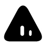</picture>

**¿Sabías?** Los datos se concentran en pocas especies: **15 especies reúnen la mitad de los 178.307 registros**. Encabezan la lista *Dendrobates truncatus* (17.724), *Engystomops pustulosus* (12.903) y *Diasporus gularis* (9.055).

<br clear="left">

| Familia | Especies | En el modelo |
|---|--:|--:|
| Craugastoridae | 95 | 12 |
| Hylidae | 48 | 19 |
| Dendrobatidae | 40 | 1 |
| Centrolenidae | 34 | 0 |
| Bufonidae | 27 | 3 |

**Análisis.**
- El modelo conoce 41 de 300 especies (14 %), y esas 41 suman el 52 % de los registros (91.858).
- 146 especies (49 %) tienen menos de 100 registros.
- Craugastoridae es la familia más diversa y el modelo cubre 12 de sus 95 especies, y de Centrolenidae (34 especies) cubre 0.

### Campo 2 · Centroides

<picture><source media="(prefers-color-scheme: dark)" srcset="docs/mascota/nube-alerta-oscuro.svg"></picture>

**Ojo.** Un **centroide** resume una especie en un punto: la media de los vectores de sus fotos de entrenamiento. Cuanto más lejos queda de su vecino, mejor se identifica la especie. Lo que explica el acierto es la **separación** entre centroides; la cantidad de fotos casi no influye.

<br clear="left">

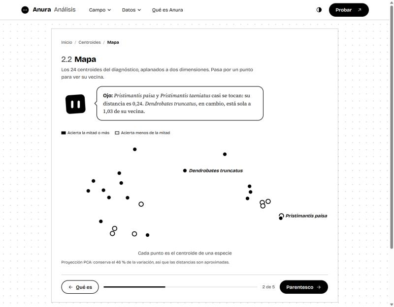

| Relación entre dos especies | Pares | Distancia media | Rango |
|---|--:|--:|---|
| Mismo género | 35 | 0,61 | 0,24 a 0,96 |
| Misma familia, otro género | 72 | 0,82 | 0,34 a 1,16 |
| Otra familia | 169 | 1,08 | 0,72 a 1,38 |

| Medida (24 especies) | Correlación con el acierto |
|---|--:|
| Separación respecto a la especie más parecida | **0,60** |
| Fracción de fotos con margen negativo | −0,44 |
| Número de fotos | 0,06 |

**Análisis.**
- El espacio del modelo ordena por parentesco: las especies de otra familia quedan 1,8 veces más lejos que las del mismo género.
- *Pristimantis paisa* y *P. taeniatus* están a 0,24 y la primera acierta el 40 %. *Dendrobates truncatus* está a 1,03 de su vecina y acierta el 98 %.
- *Dendropsophus bogerti* tiene 814 fotos y acierta el 33 %: su vecina, *D. microcephalus*, queda a 0,33.
- En promedio por especie, el 19,5 % de las fotos queda más cerca del centroide de un rival que del suyo.

### Campo 3 · Precisión

<picture><source media="(prefers-color-scheme: dark)" srcset="docs/mascota/circulo-feliz-oscuro.svg"></picture>

**Resumen.** Solo con la foto, el modelo acierta a la primera el **57,05 %** y tiene la respuesta entre sus tres primeras el **82,38 %** (41 especies, 766 fotos de prueba). La precisión baja cuando una especie comparte género con muchas otras.

<br clear="left">

| Género | Especies en el modelo | Top-1 |
|---|--:|--:|
| *Rhinella* | 3 | 74,5 % |
| *Phyllomedusa* | 2 | 69,4 % |
| *Boana* | 8 | 57,7 % |
| *Pristimantis* | 11 | 44,2 % |
| *Dendropsophus* | 9 | 37,0 % |

| Par que más se confunde | Confusiones |
|---|--:|
| *Dendropsophus ebraccatus* ↔ *D. triangulum* | 15 |
| *Craugastor raniformis* ↔ *Pristimantis achatinus* | 10 |
| *Phyllomedusa tarsius* ↔ *P. venusta* | 9 |
| *Dendropsophus mathiassoni* ↔ *D. reticulatus* | 9 |

**Análisis.**
- 11 especies superan el 80 % y 10 no llegan al 30 %. Aciertan todas sus fotos *Dendrobates truncatus*, *Pithecopus hypochondrialis* y *Rheobates palmatus*; *Dendropsophus columbianus* y *D. norandinus* quedan en 0 %.
- 10 de los 12 pares más confundidos pertenecen al mismo género.
- Correlación entre especies del mismo género y acierto: −0,48. Entre fotos de entrenamiento y acierto: 0,08.

<picture><source media="(prefers-color-scheme: dark)" srcset="docs/mascota/cubo-sorpresa-oscuro.svg"></picture>

**Cuidado: *Rhinella horribilis*.** Acierta el 90 % de sus 10 fotos, pero el modelo la nombra 16 veces y solo 9 eran suyas: su precisión es del 56 %. Funciona como un cajón al que llegan fotos de otros sapos. Con ella, el top-1 global es 57,05 %; sin ella, 56,61 %.

<br clear="left">

### Campo 4 · Mejora

<picture><source media="(prefers-color-scheme: dark)" srcset="docs/mascota/cubo-celebra-oscuro.svg">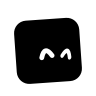</picture>

**Para recordar.** Saber dónde se tomó la foto es la mejora más grande medida: con peso 0,75 para la ubicación, el acierto pasa de **57,2 % a 82,1 %** (680 fotos con coordenadas).

<br clear="left">

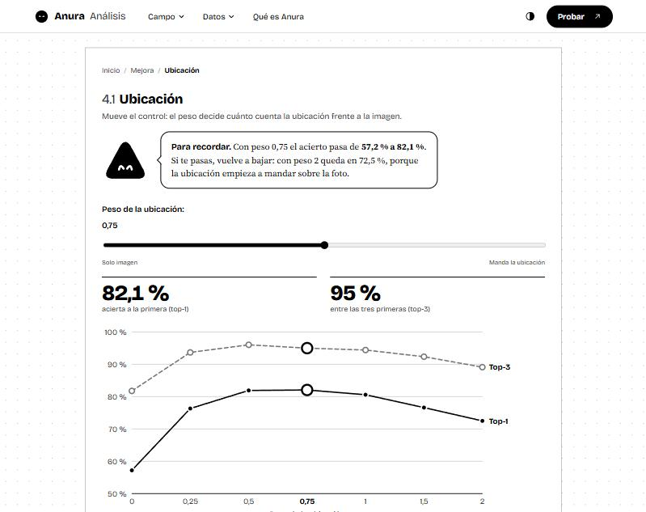

| Peso de la ubicación | Top-1 | Top-3 |
|--:|--:|--:|
| 0 (solo imagen) | 57,2 % | 81,8 % |
| 0,25 | 76,3 % | 93,7 % |
| 0,5 | 81,9 % | 96,0 % |
| **0,75** | **82,1 %** | 95,0 % |
| 1 | 80,6 % | 94,4 % |
| 1,5 | 76,6 % | 92,4 % |
| 2 | 72,5 % | 89,1 % |

| Distancia mínima a la observación más cercana | Fotos | Solo imagen | Con ubicación |
|--:|--:|--:|--:|
| 0 km | 607 | 57,2 % | 81,4 % |
| 1 km | 333 | 59,5 % | 82,0 % |
| 5 km | 151 | 58,3 % | 79,5 % |
| 10 km | 72 | 55,6 % | 70,8 % |
| 25 km | 10 | 60,0 % | 60,0 % |

| Ranking (7.475 fotos, 24 especies) | Solo imagen | Imagen + ubicación (peso 0,3) |
|---|--:|--:|
| Top-1 | 58,5 % | 66,2 % |
| Top-3 | 81,4 % | 86,7 % |
| Top-5 | 89,3 % | 92,0 % |
| MRR | 0,715 | 0,774 |

**Análisis.**
- La ubicación ayuda cuando existen observaciones cercanas: la ganancia se mantiene hasta 5 km y cae a 10 km.
- De las 24 especies del ranking, 12 mejoran, 2 bajan y 10 se mantienen. *Dendropsophus bogerti* pasa de 33 % a 81 %, *Pristimantis paisa* de 40 % a 81 % y *Phyllomedusa venusta* de 50 % a 86 %.
- Un peso demasiado alto empieza a restar: con peso 2 el top-1 baja a 72,5 %.

| Modelo en el teléfono | Tamaño | Top-1 | Top-3 |
|---|--:|--:|--:|
| 32 bits (original) | 328,9 MB | 56,79 % | 82,38 % |
| 16 bits | 164,4 MB | 56,66 % | 82,38 % |
| 8 bits | 166,9 MB | 51,44 % | 77,94 % |

Pasar a 16 bits reduce el tamaño a la mitad y conserva el acierto.

### Campo 5 · Open set

<picture><source media="(prefers-color-scheme: dark)" srcset="docs/mascota/flor-guino-oscuro.svg">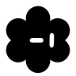</picture>

**Truco.** Ante una especie que el modelo desconoce, la respuesta correcta es «no la conozco». Se midió con 7.475 fotos de especies conocidas y 620 de especies desconocidas (7 especies). Solo con la imagen, el **93,4 %** de las desconocidas pasan por conocidas; con ubicación en dos etapas baja al **87,1 %**.

<br clear="left">

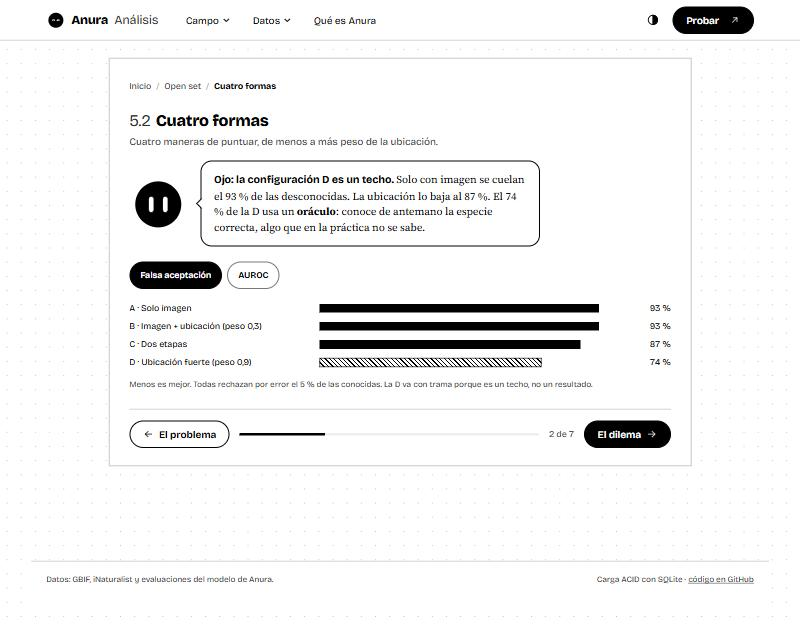

| Configuración | Top-1 en conocidas | AUROC (IC 95 %) | Falsa aceptación |
|---|--:|---|--:|
| A · Solo imagen | 58,5 % | 0,573 (0,541 a 0,606) | 93,4 % |
| B · Imagen + ubicación (peso 0,3) | 66,2 % | 0,610 (0,582 a 0,638) | 93,4 % |
| C · Dos etapas | 66,2 % | 0,603 (0,576 a 0,633) | 87,1 % |
| D · Ubicación fuerte (peso 0,9) | 41,1 % | 0,701 (0,673 a 0,730) | 74,2 % |

El falso rechazo es 5 % en las cuatro.

| Especie desconocida | Fotos | Detectada solo con imagen | Detectada con ubicación fuerte |
|---|--:|--:|--:|
| *Smilisca phaeota* | 107 | 6,5 % | 77,6 % |
| *Scinax rostratus* | 100 | 19,0 % | 26,0 % |
| *Espadarana prosoblepon* | 87 | 0,0 % | 16,1 % |
| *Craugastor metriosistus* | 85 | 3,5 % | 15,3 % |
| *Leptodactylus fragilis* | 84 | 4,8 % | 15,5 % |
| *Rhinella marina* | 83 | 2,4 % | 3,6 % |
| *Dendropsophus labialis* | 74 | 8,1 % | 10,8 % |

| Decisión en tres estados | Conocida | No concluyente | Incompatible con la zona |
|---|--:|--:|--:|
| 7.475 fotos conocidas | 1.511 | 1.028 | 4.936 |
| 620 fotos desconocidas | 31 | 153 | 436 |

**Análisis.**
- **Dos etapas:** ordenar con peso 0,3 y decidir con peso 0,9 conserva el top-1 de 66,2 % y baja la falsa aceptación. Con una sola puntuación y peso 0,9 el top-1 cae a 41,1 %.
- **La configuración D es un techo:** usa la especie correcta de las fotos conocidas, un dato que en la práctica se desconoce. Marca hasta dónde puede llegar la ubicación.
- **Ampliar el catálogo** reduce el problema de raíz: cada especie que entra al modelo deja de ser desconocida. Es una proyección, no una medición.

<picture><source media="(prefers-color-scheme: dark)" srcset="docs/mascota/circulo-alerta-oscuro.svg">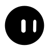</picture>

**Ojo: *Rhinella marina*.** Aporta 83 de las 620 fotos desconocidas y es la que peor se detecta (2,4 % con imagen). Sola tiene un AUROC de 0,30, por debajo del azar: al modelo le parece más conocida que las propias conocidas. Es muy parecida a *Rhinella horribilis*, que sí está en el catálogo.

<br clear="left">

| AUROC | Las 7 especies | Sin *R. marina* | Solo *R. marina* |
|---|--:|--:|--:|
| Solo imagen | 0,573 | 0,616 | 0,299 |
| Ubicación fuerte | 0,701 | 0,722 | 0,566 |

## Pila tecnológica

| Capa | Tecnología |
|---|---|
| Lenguajes | Python 3.12 o superior (carga de datos), HTML, CSS y JavaScript (web) |
| Librerías | `numpy` (proyección de centroides), módulos estándar `sqlite3`, `json` y `csv` |
| Dashboard | Web estática con gráficos SVG y animaciones CSS, sin dependencias externas |
| Base de datos | SQLite con transacciones |
| Diseño | Sistema Notas Dot Grid: monocromo, cuadrícula de puntos y mascota |
| Control de versiones y despliegue | Git, GitHub y GitHub Pages |

## Metodología ágil (Scrum + XP)

**Scrum.** El trabajo avanza por incrementos que se revisan antes de pasar al siguiente.

- **Backlog:** los cinco campos y sus subsecciones. Cada historia sigue la forma «como analista quiero saber…».
- **Incremento:** un campo es una entrega que funciona por sí sola (`index.html` + `modulo.js`).
- **Revisión:** cada incremento se revisa y se ajusta antes de seguir.

**XP.** Prácticas técnicas aplicadas:

- **Diseño simple:** datos en JSON y web estática.
- **Entregas pequeñas:** un campo a la vez.
- **Pruebas automáticas:** `build_data.py` recalcula el top-1 global y los AUROC desde la base y los compara con los valores de las fuentes; si no coinciden, la carga se revierte.
- **Código compartido:** todo vive en GitHub.

## Ciclo de Machine Learning (CRISP-ML)

1. **Comprensión del negocio.** Anura identifica anuros en campo; el análisis explica cómo la distribución de las especies y los centroides influyen en la precisión y en el open set.
2. **Comprensión de los datos.** 300 especies, 178.307 registros de GBIF, 41 especies en el modelo y 8.095 fotos de la evaluación de open set.
3. **Preparación de los datos.** `build_data.py` lee las fuentes, las valida contra `schema.sql` y exporta los JSON.
4. **Modelado.** El modelo se entrena en el proyecto Anura; este repositorio recibe sus resultados y los analiza.
5. **Evaluación.** Top-1 57,05 %, top-3 82,38 %; con ubicación, top-1 82,1 %; open set con AUROC 0,573 → 0,603 y falsa aceptación 93,4 % → 87,1 %.
6. **Despliegue.** La web se publica en GitHub Pages y la base SQLite queda disponible para descarga.

## Arquitectura de datos: transacciones ACID

<picture><source media="(prefers-color-scheme: dark)" srcset="docs/mascota/gota-reposo-oscuro.svg">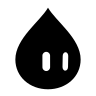</picture>

**Dato de clase.** Las cifras de la web pasan por una carga ACID. El script lee las evaluaciones de Anura, las valida dentro de **una sola transacción** de SQLite y solo entonces exporta los JSON. Si una fila rompe una regla del esquema, la carga se revierte y la web mantiene la versión anterior.

<br clear="left">

```text
D:\Anura  ──►  src/build_data.py  ──►  database/anura_acid.db  ──►  data/*.json  ──►  web
 (lectura)     BEGIN IMMEDIATE … COMMIT      (SQLite)             (escritura atómica)
```

- **Atomicidad.** La carga es una transacción: todo se guarda o nada.
- **Consistencia.** Las restricciones `CHECK` y las claves foráneas de `database/schema.sql` validan cada fila (porcentajes entre 0 y 1, top-3 mayor o igual que top-1, AUROC dentro de su intervalo).
- **Aislamiento.** `BEGIN IMMEDIATE` reserva la base mientras se escribe.
- **Durabilidad.** Tras el `COMMIT` la base queda en disco; los JSON se escriben en un temporal y se renombran.

Diez tablas: `especie_catalogo`, `modelo_especie`, `par_confundible`, `cuantizacion`, `prior_barrido`, `ranking_especie`, `openset_config`, `openset_muestra`, `centroide_especie` y `separacion_taxonomica`.

| Fuente en `D:\Anura` | Alimenta |
|---|---|
| `COLOMBIA_ANURA/taxonomy` y caché de GBIF | Campo 1 · Distribución |
| `validation/fase19_embedding_separability` | Campo 2 · Centroides |
| `bioclip/evaluation/fase_5_completa.json` | Campo 3 · Precisión |
| `bioclip/evaluation/prior_geografico.json` y `validation/fase23a_geographic_context` | Campo 4 · Mejora |
| `validation/fase23a_geographic_context` (GEO4 y GEO6) | Campo 5 · Open set |

## Instalación y puesta en marcha

1. Instala Python 3.12 o superior y `numpy`.

   ```bash
   pip install numpy
   ```

2. Carga y valida los datos. Lee `D:\Anura`; con `ANURA_DIR` se indica otra ruta.

   ```bash
   python src/build_data.py
   ```

3. Sirve la web con un servidor local.

   ```bash
   python -m http.server 8765
   ```

4. Abre `http://localhost:8765/home/`.

## Uso de la web

<picture><source media="(prefers-color-scheme: dark)" srcset="docs/mascota/flor-celebra-oscuro.svg">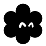</picture>

**Para recordar.** La navegación es en profundidad: cada pantalla lleva a otra más pequeña, y así la información aparece poco a poco.

<br clear="left">

```text
Inicio  →  Campo  →  Subsección  →  Detalle
 dona      tarjetas    un gráfico     fichas, tablas
                       + la mascota   y secciones que se abren
```

1. **Inicio.** Portada con una dona que cambia al tocar una ficha, qué es Anura y los cinco campos.
2. **Campo.** Muestra sus subsecciones como tarjetas, con una cifra cada una.
3. **Subsección.** Un título, el bocadillo de la mascota y un gráfico.
4. **Detalle.** Fichas para filtrar y tablas bajo «Ver los datos en tabla».

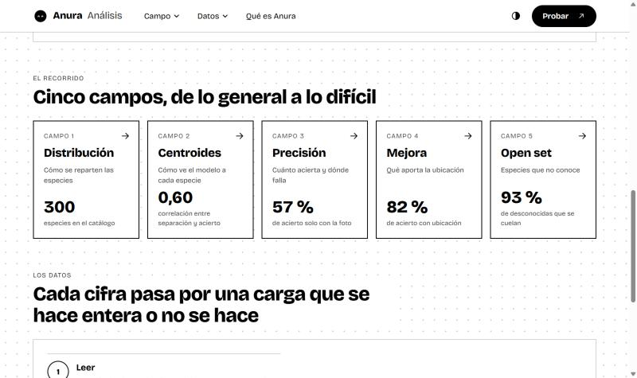

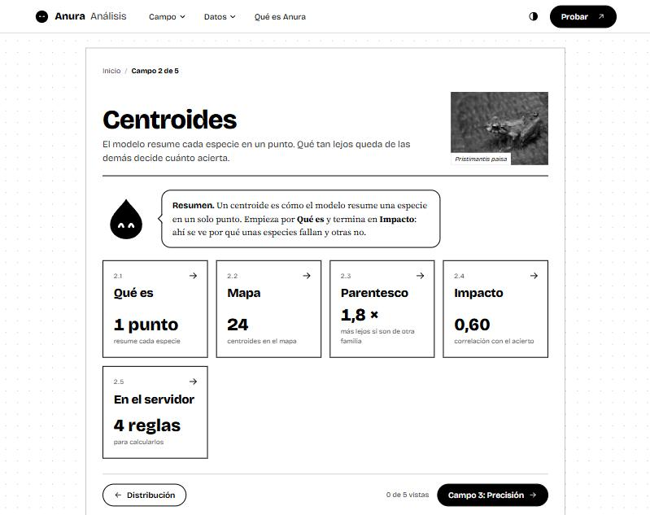

| Barra superior | Qué hace |
|---|---|
| **Campo ▾** | Al pasar el ratón se despliega el panel con los cinco campos. |
| **Datos ▾** | Carga ACID, base SQLite y código. |
| **Qué es Anura** | Lleva a la explicación de la app. |
| **Probar ↗** | Abre [anura.juanlabs.me/inicio](https://anura.juanlabs.me/inicio) en otra pestaña. |
| **Tres líneas** | En móvil, el menú se convierte en un cajón con los campos y el botón Probar. |

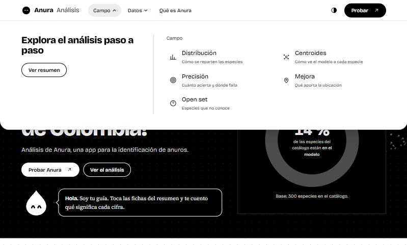

## Publicación en GitHub

```bash
git add .
git commit -m "Actualiza el análisis"
git push origin main
```

GitHub Pages sirve la rama `main` desde la raíz: **Settings → Pages → Deploy from a branch → `main` / `/ (root)`**. La web queda en `https://mogollo7.github.io/analisis-anura/`.

## Cómo leer las cifras

<picture><source media="(prefers-color-scheme: dark)" srcset="docs/mascota/gota-feliz-oscuro.svg"></picture>

**Resumen.** Cada resultado se acompaña de su base de fotos y de su fuente, para citarlo con precisión.

<br clear="left">

- **Bases distintas.** Las evaluaciones usan conjuntos de prueba diferentes (766, 680 y 8.095 fotos); cada cifra se lee con su propia base.
- **Umbrales de diagnóstico.** Los de open set se ajustaron con las mismas fotos con que se evalúan, así que orientan el comportamiento del modelo. El conjunto de calibración independiente reúne 17 fotos desconocidas.
- **Centroides.** Las cifras provienen del diagnóstico de 24 especies, calculado con el mismo método del módulo de administración de Anura.
- **Ubicación a 25 km.** El resultado de esa fila se apoya en 10 fotos.
- **Paquete de Antioquia.** Es una simulación con las 41 especies y queda como referencia interna.
- **Proyecciones.** Lo marcado como «(extra)» o «proyección» en la web es una estimación.
