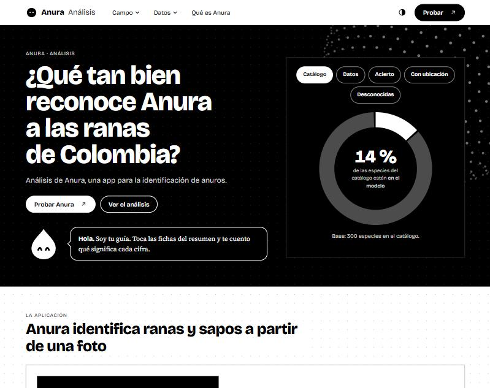
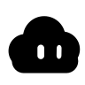

# Anura · Análisis

<picture><source media="(prefers-color-scheme: dark)" srcset="docs/mascota/gota-feliz-oscuro.svg"></picture>

**Resumen.** Esta web analiza **Anura**, una app para la identificación de anuros (ranas y sapos) de Colombia. Muestra cómo se reparten las especies, cuánto acierta el modelo y qué pasa cuando ve una que no conoce. Para usar la app, pulsa **Probar**: [anura.juanlabs.me/inicio](https://anura.juanlabs.me/inicio).

<br clear="left">



## Lo que dice el análisis

| Cifra | Qué es |
|---|---|
| **300** especies | El catálogo, en 14 familias. |
| **41** especies | Las que el modelo sabe identificar. |
| **57 %** | Acierto a la primera solo con la foto (766 fotos de prueba). |
| **82 %** | Acierto con foto y ubicación (680 fotos con coordenadas). |
| **0,60** | Correlación entre la separación de los centroides y el acierto. Con el número de fotos es 0,06. |
| **93 % → 87 %** | Fotos de especies desconocidas que pasan por conocidas: solo imagen frente a dos etapas con ubicación. |

<picture><source media="(prefers-color-scheme: dark)" srcset="docs/mascota/circulo-alerta-oscuro.svg"></picture>

**Ojo: cada cifra tiene su propia base.** Salen de conjuntos de prueba distintos (766, 680 y 8.095 fotos). La web siempre pone la base al lado y nunca las mezcla en un solo total.

<br clear="left">

## Cómo está organizada la web

<picture><source media="(prefers-color-scheme: dark)" srcset="docs/mascota/nube-pensando-oscuro.svg"></picture>

**Para recordar.** La navegación es en profundidad: cada pantalla lleva a una más pequeña. No hay columna lateral ni un árbol a la vista. Así la información se ve poco a poco y nunca toda junta.

<br clear="left">

```
Inicio  →  Campo  →  Subsección  →  Detalle
 dona      tarjetas    un gráfico     fichas, tablas
                       + la mascota   y secciones que se abren
```

- **Inicio.** Portada, una dona que cambia al tocar una ficha, qué es Anura y los cinco campos.
- **Campo.** Muestra solo sus subsecciones, como tarjetas con una cifra cada una.
- **Subsección.** Un título, el bocadillo de la mascota y un único gráfico.
- **Detalle.** Lo fino se abre dentro: fichas para filtrar, tablas bajo «Ver los datos en tabla».

### La barra superior

| Elemento | Qué hace |
|---|---|
| **Campo ▾** | Al pasar el ratón se despliega un panel con los cinco campos. |
| **Datos ▾** | Carga ACID, base SQLite y código. |
| **Qué es Anura** | Lleva a la explicación de la app. |
| **Probar ↗** | Abre la web de Anura, [anura.juanlabs.me/inicio](https://anura.juanlabs.me/inicio), en otra pestaña. |
| **Tres líneas** | En móvil, el menú pasa a un cajón con los campos y el botón Probar. |

### Los cinco campos

| Campo | Pregunta que responde | Subsecciones |
|---|---|---|
| **1 · Distribución** | ¿Cómo se reparten las especies? | Familias · Registros · Cola larga · Explorar |
| **2 · Centroides** | ¿Cómo ve el modelo a cada especie? | Qué es · Mapa · Parentesco · Impacto · En el servidor |
| **3 · Precisión** | ¿Cuánto acierta y dónde falla? | Hoy · Por género · Por especie · Confusiones · *Rhinella horribilis* |
| **4 · Mejora** | ¿Qué aporta la ubicación? | Ubicación · Cerca o lejos · Quién gana · En el teléfono |
| **5 · Open set** | ¿Qué hace con especies que no conoce? | El problema · Cuatro formas · El dilema · Por especie · *Rhinella marina* · Tres estados · Cómo reducirlo |


## La mascota

<picture><source media="(prefers-color-scheme: dark)" srcset="docs/mascota/cubo-celebra-oscuro.svg"></picture>

**Dato de clase.** La mascota acompaña cada pantalla con un bocadillo. Flota, parpadea, te sigue con la mirada y salta cuando cambia de tema. La etiqueta en negrita del bocadillo decide su expresión: **Resumen**, **Ojo**, **Cuidado**, **Truco**, **¿Sabías?**, **Para recordar**. Se anima con CSS y JavaScript; con «reducir movimiento» activado en el sistema, se queda quieta.

<br clear="left">

| | | | | | |
|:-:|:-:|:-:|:-:|:-:|:-:|
|  |  |  |  |  |  |
| Resumen | Ojo | Ejemplo | Para recordar | ¿Sabías? | Truco |

## Capturas

Todas son de la versión de escritorio.


*Campo 2 · Mapa. Cada punto es el centroide de una especie; al pasar por encima se dibuja la línea hasta su vecina.*


*Un campo muestra solo sus subsecciones.*


*Campo 4 · Ubicación. Mueve el control y el acierto cambia en vivo: de 57,2 % a 82,1 % con peso 0,75.*


*Campo 5 · Cuatro formas. La barra con trama es un techo, no un resultado.*


*La barra superior: al pasar el ratón sobre «Campo» se despliega el panel con los cinco campos. A la derecha, el botón Probar.*

## De dónde salen los datos

<picture><source media="(prefers-color-scheme: dark)" srcset="docs/mascota/triangulo-duda-oscuro.svg"></picture>

**¿Sabías?** Nada se escribe a mano. Un script lee las evaluaciones del proyecto Anura, las valida dentro de **una sola transacción** de SQLite y solo entonces exporta los JSON que lee la web. Si una fila rompe una regla del esquema, se revierte todo y la web sigue mostrando la versión anterior.

<br clear="left">

```
D:\Anura  ──►  src/build_data.py  ──►  database/anura_acid.db  ──►  data/*.json  ──►  web
 (solo lectura)   BEGIN IMMEDIATE …COMMIT       (SQLite)             (escritura atómica)
```

| Letra | Cómo se cumple |
|---|---|
| **A**tomicidad | Una transacción: todo o nada. |
| **C**onsistencia | Las restricciones `CHECK` y las claves foráneas de `database/schema.sql`. |
| **A**islamiento | `BEGIN IMMEDIATE` bloquea la base mientras se escribe. |
| **D**urabilidad | Tras el `COMMIT` la base queda en disco; los JSON se escriben a un temporal y se renombran. |

La web publicada solo lee. La garantía ACID vive en la carga, no en el navegador.

| Fuente en `D:\Anura` | Alimenta |
|---|---|
| `COLOMBIA_ANURA/taxonomy` y caché de GBIF | Campo 1 · Distribución |
| `validation/fase19_embedding_separability` | Campo 2 · Centroides |
| `bioclip/evaluation/fase_5_completa.json` | Campo 3 · Precisión |
| `bioclip/evaluation/prior_geografico.json` y `validation/fase23a_geographic_context` | Campo 4 · Mejora |
| `validation/fase23a_geographic_context` (GEO4 y GEO6) | Campo 5 · Open set |

## Estructura del repositorio

```
index.html            redirige a /home/
home/                 inicio
distribucion/  centroides/  precision/  mejora/  openset/
                      un campo cada uno: index.html + modulo.js
assets/               app.js, app.css, tokens.css, ndg.js, ndg.css, fotos/
data/                 JSON que lee la web (los genera build_data.py)
database/             schema.sql y anura_acid.db
src/build_data.py     la carga ACID
docs/                 capturas y mascotas de este README
```

`ndg.js`, `ndg.css` y `tokens.css` son el sistema de diseño **Notas Dot Grid**: monocromo, con la cuadrícula de puntos en el margen, tres familias tipográficas y la mascota.

## Ejecutarlo

Necesitas Python 3.12 o superior y `numpy`.

```bash
python src/build_data.py          # carga y valida; lee D:\Anura (cámbialo con ANURA_DIR)
python -m http.server 8765        # sirve la web
```

Abre `http://localhost:8765/home/`. No abras los `.html` con doble clic: el navegador bloquea la lectura de los JSON.

### GitHub Pages

En el repositorio [Mogollo7/analisis-anura](https://github.com/Mogollo7/analisis-anura): **Settings → Pages → Deploy from a branch → `main` / `/ (root)`**. Todas las rutas son relativas y el archivo `.nojekyll` evita que Pages procese las carpetas.

## Metodología

**Ágil.** El trabajo se hizo en iteraciones cortas: cada entrega se revisa antes de pasar a la siguiente.

**CRISP-ML(Q).** Fases aplicadas a esta web. El modelo se entrenó en el proyecto Anura; aquí solo se analiza.

| Fase | Qué hay en este proyecto |
|---|---|
| Comprensión del negocio | Una app que identifica anuros en campo y no debe inventar especies. |
| Comprensión de los datos | Taxonomía, registros de GBIF y evaluaciones del modelo. |
| Preparación | `build_data.py`: carga ACID y cruces entre fuentes. |
| Modelado | Fuera de este repositorio. |
| Evaluación | Top-1, top-3, AUROC y falsa aceptación, con su base. |
| Despliegue | GitHub Pages. |

## Límites y avisos

<picture><source media="(prefers-color-scheme: dark)" srcset="docs/mascota/flor-guino-oscuro.svg"></picture>

**Truco: lee las notas antes de citar una cifra.**

<br clear="left">

- **Rhinella.** *Rhinella horribilis* acierta el 90 % de sus 10 fotos, pero el modelo la nombra 16 veces y solo 9 eran suyas: funciona como un cajón. Quitarla mueve el top-1 global de 57,05 % a 56,61 %. *Rhinella marina* no está en el catálogo y aporta 83 de las 620 fotos desconocidas; sola tiene un AUROC de 0,30, peor que el azar. Sin ella, el AUROC visual pasa de 0,573 a 0,616. Son dos especies muy parecidas a simple vista, tratadas durante mucho tiempo como una sola. Es contexto taxonómico, no un resultado de los archivos de evaluación.
- **Umbrales de diagnóstico.** Los de open set se ajustaron con las mismas fotos con las que se evalúan: sirven para entender, no para producción. El conjunto de calibración tenía solo 17 fotos desconocidas.
- **La configuración D es un techo.** Usa la especie correcta de las fotos conocidas, algo que en la práctica no se sabe.
- **Centroides.** Los del servidor de Anura viven en su base Postgres y no se publican. Las cifras de esta web vienen del diagnóstico de 24 especies, calculado con el mismo método.
- **Paquete de Antioquia.** Es una simulación con las 41 especies y no se muestra.
- **La ubicación solo ayuda si hay observaciones cerca.** A 25 km o más no aporta, pero son 10 fotos y esa cifra es poco fiable.
- **Proyecciones.** Lo marcado como «(extra)» o «proyección» en la web no está medido.
